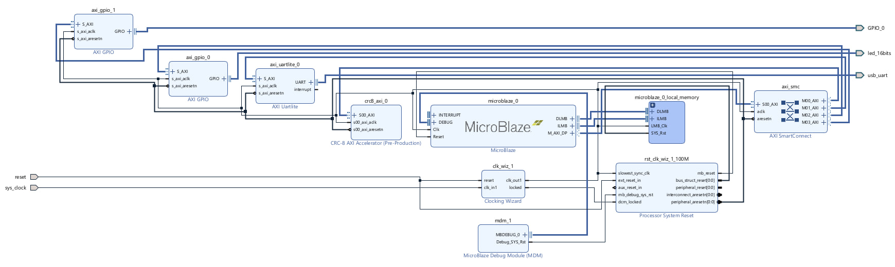
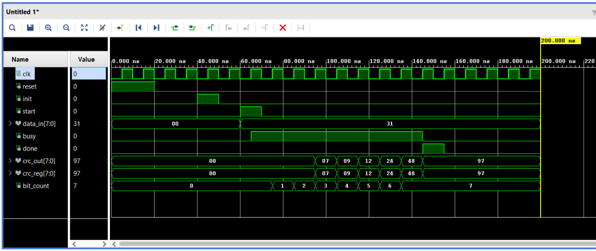
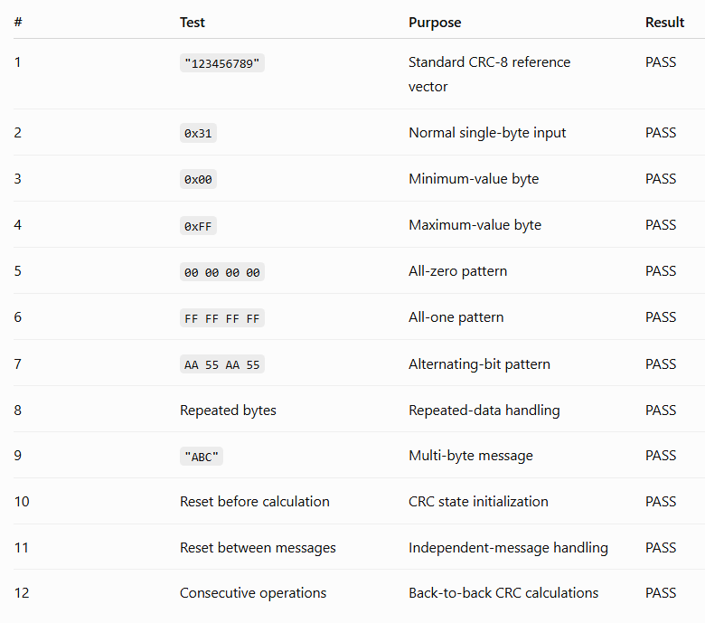
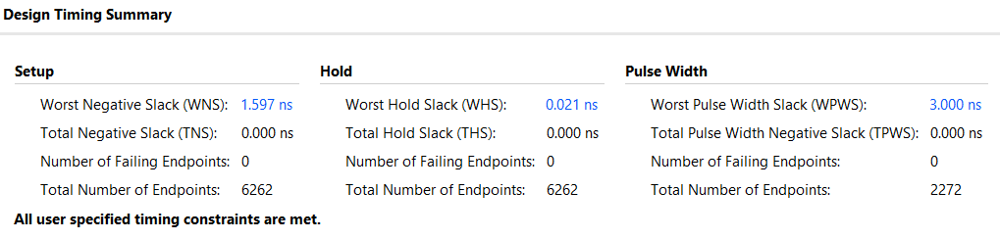
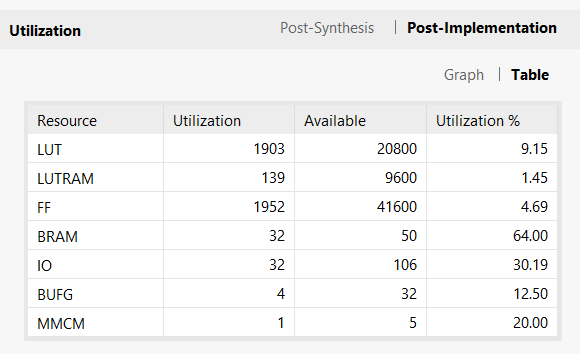

# Design and Validation

This document covers the engineering details behind the [README](../README.md): how the CRC core behaves cycle by cycle, how software and hardware synchronize across the AXI4-Lite boundary, how the MicroBlaze system is put together, and what was verified. Results are those recorded during original development; none were re-run while this repository was organized.

## Contents

- [Design Goal](#design-goal)
- [CRC-8 Core](#crc-8-core)
- [Peripheral Interface and Control Protocol](#peripheral-interface-and-control-protocol)
- [IP Package Contents](#ip-package-contents)
- [System Integration](#system-integration)
- [Board I/O](#board-io)
- [RTL Simulation](#rtl-simulation)
- [Hardware Test Suite](#hardware-test-suite)
- [Implementation Results](#implementation-results)
- [Performance Notes](#performance-notes)
- [Reconstruction Guide](#reconstruction-guide)
- [Limitations](#limitations)
- [Possible Extensions](#possible-extensions)

## Design Goal

Build a complete, small hardware/software system on an FPGA: a custom RTL block that software controls through memory-mapped registers, and a software harness that checks the hardware against an independent reference on real silicon. CRC-8 was chosen because its correct output is easy to check, which keeps attention on the integration problems: register interface design, command and status handshaking, address mapping, and on-board validation.

Scope was intentionally limited: one byte per transaction, register polling, no interrupts, no DMA, no AXI-Stream.

## CRC-8 Core

Source: [rtl/crc8_core.vhd](../rtl/crc8_core.vhd)

### Ports

| Port | Dir | Width | Description |
|---|---|---|---|
| `clk` | in | 1 | Clock (100 MHz in the integrated system) |
| `reset` | in | 1 | Synchronous, active high; clears all state |
| `init` | in | 1 | Clear the CRC register to `0x00` (ignored while busy) |
| `start` | in | 1 | Latch `data_in` and begin processing (ignored while busy) |
| `data_in` | in | 8 | Input byte |
| `busy` | out | 1 | High while a byte is being processed |
| `done` | out | 1 | One-cycle pulse when a byte finishes |
| `crc_out` | out | 8 | Current CRC register value |

### State and datapath

The core holds an 8-bit CRC register, an 8-bit input shift register, a bit counter (0–7), and the `busy`/`done` flags. Everything is updated in a single clocked process with this priority:

1. `reset`: clear CRC, data, counter, and flags.
2. `init` while idle: clear the CRC register only.
3. `start` while idle: latch `data_in`, reset the counter, set `busy`.
4. While busy: process one bit.

Per processed bit:

```text
feedback = crc[7] xor data[7]
crc      = (crc << 1) xor (feedback ? 0x07 : 0x00)
data     = data << 1
```

On the eighth bit, `busy` clears and `done` is set for exactly one cycle. `done` defaults low every clock, so it is always a pulse.

Feeding the message MSB-first into the top of the register is equivalent to the byte-wise software form used in `main.c` (`crc ^= byte`, then eight shift/conditional-XOR steps). That is why the two paths can be compared directly without any bit reflection.

### Why state is preserved across bytes

Only `reset` and `init` clear the CRC register; `start` does not. A multi-byte message is therefore sent as one `init` followed by a sequence of `start` commands, and the running CRC carries over between bytes. Software decides where messages begin, and the hardware stays independent of message length.

### Worked example: `0x31`

`0x31` = `0011 0001`, starting from CRC `0x00`:

| Cycle | Input bit | Feedback | CRC after |
|---|---|---|---|
| 1 | 0 | 0 | `0x00` |
| 2 | 0 | 0 | `0x00` |
| 3 | 1 | 1 | `0x07` |
| 4 | 1 | 1 | `0x09` |
| 5 | 0 | 0 | `0x12` |
| 6 | 0 | 0 | `0x24` |
| 7 | 0 | 0 | `0x48` |
| 8 | 1 | 1 | `0x97` |

This sequence matches the simulation waveform below.

## Peripheral Interface and Control Protocol

Source: [hardware/ip_repo/crc8_axi_1_0/](../hardware/ip_repo/crc8_axi_1_0/)

In the saved block design the peripheral is instance `crc8_axi_0` of the custom IP `xilinx.com:user:crc8_axi:1.0` (revision 3), mapped at `0x44A0_0000` with a 64 KB window.

### Hierarchy

```text
crc8_axi                              hdl/crc8_axi.vhd
└── crc8_axi_slave_lite_v1_0_S00_AXI  hdl/crc8_axi_slave_lite_v1_0_S00_AXI.vhd
    ├── AXI4-Lite slave (Vivado template: handshakes, slv_reg0..3)
    ├── custom logic: pulse generator, sticky DONE, STATUS/RESULT read mux
    └── crc8_core                     src/crc8_core.vhd
```

- [crc8_axi.vhd](../hardware/ip_repo/crc8_axi_1_0/hdl/crc8_axi.vhd) is the IP's top level as generated by Vivado's "Create and Package New IP" flow. It only maps the `s00_axi_*` ports and the 32-bit data / 4-bit address generics onto the slave module, and its user-logic section is empty.
- [crc8_axi_slave_lite_v1_0_S00_AXI.vhd](../hardware/ip_repo/crc8_axi_1_0/hdl/crc8_axi_slave_lite_v1_0_S00_AXI.vhd) is the generated AXI4-Lite slave template. The project's own logic is in the signal declarations headed `CRC core interface signals` and the `Add user logic here` section at the end, plus the replacement of the template's read-data mux for offsets `0x08` and `0x0C`.
- [src/crc8_core.vhd](../hardware/ip_repo/crc8_axi_1_0/src/crc8_core.vhd) is the IP's own copy of the core. It is byte-identical (same SHA-256) to [rtl/crc8_core.vhd](../rtl/crc8_core.vhd).

### Register map (as implemented)

| Offset | Register | Write behavior | Read returns |
|---|---|---|---|
| `0x00` | DATA | Stored in `slv_reg0`; bits `[7:0]` drive the core's `data_in` | Full 32-bit stored value |
| `0x04` | CONTROL | Stored in `slv_reg1`; bit 0 → one-clock `start`, bit 1 → one-clock `init` | Last value written (not live state) |
| `0x08` | STATUS | Accepted into `slv_reg2` but not used | `{30'b0, DONE, BUSY}`: bit 0 live `busy`, bit 1 sticky DONE |
| `0x0C` | RESULT | Accepted into `slv_reg3` but not used | `{24'b0, crc_out}`: the live CRC register |

These offsets and bits match the original write-up and the constants in `main.c`. The source adds three details the write-up did not mention: DATA and CONTROL can be read back, writes to STATUS and RESULT have no visible effect, and RESULT is live, not a snapshot. Address decoding uses AXI address bits `[3:2]` (4-bit address port, 32-bit registers), so the four registers repeat every 16 bytes across the 64 KB window assigned in the block design. All write and read responses are `OKAY`.

### AXI4-Lite transactions

The slave logic is the Vivado template, unchanged:

- **Write channel.** A small state machine keeps `WREADY` high and accepts address and data together, or address first and then data, raising `BVALID` once both have arrived. Registers are updated with byte-strobe granularity.
- **Write decode.** The target register is chosen from `AWADDR` when `AWVALID` is high, or from the last latched write address otherwise. The template therefore assumes the address arrives no later than the data. The recorded hardware tests passed with this behavior in the original system; no separate bus-level analysis was done.
- **Read channel.** `ARADDR` is latched when `ARREADY`/`ARVALID` complete, `RVALID` rises the next cycle, and `RDATA` is a combinational mux on the latched address.

### Control pulses

A separate clocked process watches for a write to offset `0x04` (`WVALID` high, address bits `[3:2] = "01"`, byte strobe 0 set). In the next cycle it drives `start_pulse <= WDATA(0)` and `init_pulse <= WDATA(1)`. Both default back to `0` on every other clock. Each CONTROL write therefore produces exactly one command, independent of the value left in `slv_reg1`. Writing CONTROL with both bits clear produces no command.

If START and INIT are written together, both pulses reach the core in the same cycle. The core's priority means INIT is taken and START is dropped. `main.c` never writes both bits at once.

### Sticky DONE

`done_sticky` is a flag in the wrapper with this priority, evaluated each clock:

1. AXI reset (`S_AXI_ARESETN = '0'`) → clear
2. `init_pulse` → clear
3. `start_pulse` → clear
4. core `done` pulse → set

DONE therefore stays set from the end of one byte until software issues the next START or INIT. In particular, a new START clears the previous byte's DONE. The clear happens in the same clock in which the core latches the byte, so by static reading of the source, a STATUS read issued after the START write has completed does not see stale DONE.

Because the pulse generator does not check `busy`, a START or INIT written while a byte is in flight still clears `done_sticky`, even though the core ignores the command. DONE then sets normally when the in-flight byte finishes. The driver never writes CONTROL while busy, so this path is not exercised.

### Core integration and timing

- **Clock and reset.** The core runs on `S_AXI_ACLK`, the same clock as the AXI interface, so there is no clock-domain crossing. Its active-high synchronous `reset` is `not S_AXI_ARESETN`, so the processor system reset clears the CRC state together with the bus logic.
- **Data path.** `slv_reg0(7 downto 0)` connects directly to `data_in`. The core copies it into its own shift register on `start`, so a later DATA write cannot disturb a byte in flight.
- **Status and result.** `busy` and `crc_out` connect directly to STATUS bit 0 and RESULT `[7:0]`. CRC state persists across bytes because only `init` and reset clear the core's register.
- **Latency (static reading of the RTL, not measured).** The clock edge that accepts the CONTROL write also registers `start_pulse`. On the next edge the core latches the byte and asserts `busy`, the following eight edges process the bits, and one more edge sets `done_sticky`. DONE is therefore readable about ten clock periods (about 100 ns at 100 MHz) after the START write is accepted, not counting interconnect latency.

### Driver sequence

From [software/main.c](../software/main.c):

```text
write CONTROL = INIT (0x2)                  # init pulse: CRC <- 0x00, DONE cleared
for each byte:
    write DATA    = byte                    # slv_reg0[7:0] -> core data_in
    write CONTROL = START (0x1)             # start pulse: core latches byte, DONE cleared
    poll STATUS until bit 1 (DONE) is set   # max 1,000,000 reads, else TIMEOUT
read RESULT                                 # live crc_out in [7:0]
```

The driver uses plain `Xil_Out32` / `Xil_In32` with its own offset and bit definitions, at the base address `XPAR_CRC8_AXI_0_BASEADDR` from the Vitis-generated `xparameters.h`. It does not use the generated `CRC8_AXI_mWriteReg` / `mReadReg` macros in the IP's driver folder. It checks only the DONE bit; BUSY is exposed but not polled. The hardware result is compared in C against `crc8_software()`, a bitwise implementation with the same polynomial, initial value, and bit order. A test passes only if the hardware completed without timeout, both CRCs match, and the software CRC equals the fixed expected value where one is defined.

The polling bound turns a hung or mis-addressed peripheral into a reported `TIMEOUT` failure instead of a frozen processor. The hardware-path helpers take an `initialize_first` flag, so the test harness can deliberately skip INIT. The reset-before and reset-between tests use this to load the CRC register with leftover state before showing that INIT clears it.

## IP Package Contents

[hardware/ip_repo/crc8_axi_1_0/](../hardware/ip_repo/crc8_axi_1_0/) is the Vivado IP repository entry used by the block design.

| Path | Origin | Role |
|---|---|---|
| `component.xml` | Generated by Vivado IP Packager | IP-XACT description: VLNV `xilinx.com:user:crc8_axi:1.0`, core revision 3, display name "CRC-8 AXI Accelerator", Vivado 2024.2, `artix7` family (marked Pre-Production, which is why the block design shows that label), one AXI4-Lite slave with a 4 KB address block |
| `hdl/crc8_axi.vhd` | Vivado template, unmodified | IP top level |
| `hdl/crc8_axi_slave_lite_v1_0_S00_AXI.vhd` | Vivado template + project logic | AXI4-Lite slave, register map, control pulses, sticky DONE, core instance |
| `src/crc8_core.vhd` | Project source | CRC-8 core (identical to `rtl/crc8_core.vhd`) |
| `xgui/crc8_axi_v1_0.tcl` | Generated | IP customization GUI |
| `bd/bd.tcl` | Generated | Block-design parameter propagation hooks |
| `drivers/crc8_axi_v1_0/` | Generated template | Register access macros and a register write/read-back self-test; not used by `main.c` |
| `example_designs/` | Generated template | AXI VIP (BFM) and hardware-debug example designs; not used in the recorded results |

**Consistency with the block design.** The VLNV and core revision (3) match the `crc8_axi_0` instance in `system.bd`. The packaged port names (`s00_axi_*`) match the nets in the block design. The 4 KB address block sits inside the 64 KB segment assigned at `0x44A0_0000`. Every file referenced by `component.xml` is present, and the IP needs no other source files. Because the IP carries its own copy of the core, it does not depend on `rtl/`.

**Observations (not changed):**

- The **synthesis** file set lists both `hdl/` files and `src/crc8_core.vhd`. The **behavioral-simulation** file set lists only the two `hdl/` files. Simulating the packaged IP through its simulation view would therefore leave the `crc8_core` entity unresolved unless the core is added separately. Synthesis and implementation, which produced the recorded bitstream, use the synthesis file set.
- The generated driver self-test (`CRC8_AXI_Reg_SelfTest`) writes a pattern to all four registers and expects to read it back. That does not fit this register map: STATUS and RESULT are read-only views of live hardware, and a CONTROL write issues commands. It is unused template code.
- None of the IP files carry a copyright or license header.

## System Integration

The block design ([hardware/bd/system/system.bd](../hardware/bd/system/system.bd), Vivado 2024.2, part `xc7a35tcpg236-1`) contains:

| Instance | IP | Configuration notes |
|---|---|---|
| `microblaze_0` | MicroBlaze 11.0 | Data-side AXI master to the interconnect; debug via MDM |
| `microblaze_0_local_memory` | LMB + BRAM controllers + Block Memory Generator | 128 KB at `0x0000_0000`, shared by instruction and data |
| `axi_smc` | AXI SmartConnect | 1 slave port, 4 master ports |
| `crc8_axi_0` | Custom `crc8_axi:1.0` | `0x44A0_0000` |
| `axi_uartlite_0` | AXI UART Lite 2.0 | 115200 baud, Basys 3 USB-UART via board flow, `0x4060_0000` |
| `axi_gpio_0` | AXI GPIO 2.0 | Basys 3 16 LEDs via board flow, `0x4000_0000` |
| `axi_gpio_1` | AXI GPIO 2.0 | 12-bit, all outputs, seven-segment display, `0x4001_0000` |
| `clk_wiz_1` | Clocking Wizard 6.0 | Board `sys_clock` (100 MHz) in |
| `rst_clk_wiz_1_100M` | Processor System Reset 5.0 | Generates processor, interconnect, and peripheral resets |
| `mdm_1` | MicroBlaze Debug Module 3.2 | JTAG debug and program download |

All peripherals, the interconnect, and the processor run on the single clocking-wizard output. The clock, reset, UART, and LED pins are assigned through the Digilent Basys 3 board interface (board flow), so the only hand-written constraints are for the seven-segment port, in [hardware/constraints/seven_segment.xdc](../hardware/constraints/seven_segment.xdc).

### Saved IP configurations

`system.bd` records the connections, address map, and top-level parameters. Each IP instance's full configuration is in its own `.xci` file, which the block design references by relative path (`ip/<instance>/<instance>.xci`). All 14 are kept in [hardware/bd/system/ip/](../hardware/bd/system/ip/), in that layout:

| `.xci` | Instance |
|---|---|
| `system_microblaze_0_0` | `microblaze_0` |
| `system_dlmb_v10_0`, `system_ilmb_v10_0` | Data/instruction LMB buses |
| `system_dlmb_bram_if_cntlr_0`, `system_ilmb_bram_if_cntlr_0` | LMB BRAM controllers |
| `system_lmb_bram_0` | Local memory BRAM |
| `system_mdm_1_0` | `mdm_1` |
| `system_clk_wiz_1_0` | `clk_wiz_1` |
| `system_rst_clk_wiz_1_100M_0` | `rst_clk_wiz_1_100M` |
| `system_axi_smc_0` | `axi_smc` |
| `system_axi_uartlite_0_0` | `axi_uartlite_0` |
| `system_axi_gpio_0_0`, `system_axi_gpio_1_0` | `axi_gpio_0`, `axi_gpio_1` |
| `system_crc8_axi_0_0` | `crc8_axi_0`, referencing `xilinx.com:user:crc8_axi:1.0`, revision 3 |

These files hold configuration only (JSON), not generated HDL or netlists. Each contains a `gen_directory` hint pointing into the original project's `.gen` tree; Vivado sets that path again in a new project. [ui/bd_c954508f.ui](../hardware/bd/system/ui/bd_c954508f.ui) stores the canvas placement of the diagram shown in the screenshot.

### Hardware export and software flow

After implementation, the hardware was exported as [hardware/export/crc8_accelerator.xsa](../hardware/export/crc8_accelerator.xsa) (18 Aug, 02:30). The XSA is a zip archive. It contains the hardware handoff (`system.hwh`, `system_axi_smc_0.hwh`, `system.bda`, `xsa.json`, which names board `digilentinc.com:basys3:1.2` and top `system_wrapper`), the bitstream with its `.mmi` memory map, and a copy of the `crc8_axi` driver template. Its embedded bitstream is the same file as [hardware/bitstream/system_wrapper.bit](../hardware/bitstream/system_wrapper.bit) (same size and CRC32).

The Vitis platform `crc8_platform` was created from this XSA with one standalone domain on `microblaze_0` and default BSP settings: stdin/stdout on `axi_uartlite_0`, processor flags `-O2 -mlittle-endian -mxl-soft-mul -mcpu=v11.0`. The generated `xparameters.h` defines `XPAR_CRC8_AXI_0_BASEADDR` as `0x44a00000`, the macro `main.c` uses. The application `crc8_app` started from the Vitis empty-application template, with `main.c` and the linker script added, and was built with the template's debug settings (`-O0 -g3 -Wall -Wextra`). A minimal UART print application was brought up first to confirm the processor-to-terminal path before the CRC peripheral was exercised. The linker script ([software/lscript.ld](../software/lscript.ld)) is the Vitis-generated script for the 128 KB local memory, with 1 KB stack and 2 KB heap defaults.

For the demonstration, the Vitis launch configuration reset the system, programmed the FPGA with the implementation bitstream (identical to the retained `.bit`), downloaded `crc8_app.elf` to `microblaze_0` over JTAG, and started it. The bitstream does not contain the application. The local memory is filled by the JTAG download, so the `.bit` on its own does not run the test suite.



## Board I/O

**UART.** Each test prints its name, input bytes, expected value (where one is defined), software CRC, hardware CRC (or `TIMEOUT`), and PASS/FAIL, followed by a final pass count.

**LEDs.** The LEDs are cleared at startup. After the suite, LED0 lights if every test passed and LED1 lights otherwise.

**Seven-segment display.** `axi_gpio_1` drives 12 outputs:

| GPIO bits | Function |
|---|---|
| `[6:0]` | Segments CA–CG (active low) |
| `[7]` | Decimal point (held off) |
| `[11:8]` | Anodes AN0–AN3 (active low) |

The Basys 3 display shares its segment lines across all four digits, so digits have to be time-multiplexed. Here that is done in software: the driver lights AN1 with the high nibble, waits 1 ms, lights AN0 with the low nibble, and waits 1 ms. Between tests this loop runs 1,000 times (about two seconds), and after the last test it runs indefinitely. The display therefore only refreshes while software is actively running that loop.

## RTL Simulation

Testbench: [rtl/crc8_core_tb.vhd](../rtl/crc8_core_tb.vhd)

The testbench uses a 100 MHz clock. It applies reset, issues one INIT pulse, issues START with `data_in = 0x31`, waits for `done`, and asserts `crc_out = 0x97`.



The recorded Vivado behavioral simulation shows:

- `busy` high for eight clock periods after START;
- `bit_count` advancing 0 → 7;
- `crc_reg` stepping `00 → 07 → 09 → 12 → 24 → 48 → 97`, matching the worked example;
- a single-cycle `done` pulse as `busy` falls;
- final `crc_out = 0x97`.

The testbench covers one vector. Multi-byte operation, INIT between messages, and commands issued while busy were exercised on hardware through the full system rather than in RTL simulation.

## Hardware Test Suite

All 12 tests ran on the physical Basys 3 board. Every test compares the hardware CRC with the software CRC; where an expected value is listed, the software CRC is also checked against it.

| # | Test | Input | Fixed expected value | Recorded result |
|---|---|---|---|---|
| 1 | Standard check vector | `"123456789"` | `0xF4` | PASS |
| 2 | Single byte | `31` | `0x97` | PASS |
| 3 | Minimum byte | `00` | — | PASS |
| 4 | Maximum byte | `FF` | — | PASS |
| 5 | All-zero data | `00 00 00 00` | — | PASS |
| 6 | All-one data | `FF FF FF FF` | — | PASS |
| 7 | Alternating bits | `AA 55 AA 55` | — | PASS |
| 8 | Repeated bytes | `5A 5A 5A 5A` | — | PASS |
| 9 | Multi-byte message | `"ABC"` | — | PASS |
| 10 | INIT before calculation | `AA 55 12 34` (no check), INIT, then `31` | `0x97` | PASS |
| 11 | INIT between messages | `"ABC"`, INIT, then `12 34 56 78` | — | PASS |
| 12 | Back-to-back operations | `12 34`, then `DE AD BE EF` | — | PASS |

**Recorded outcome: 12 / 12 PASS.** UART output was shown in a serial terminal, the seven-segment display showed each hardware CRC, and the LED indicated the final pass state. The [demo video](../media/demo.mp4) captures this run.

Summary table from the original results:



## Implementation Results

The timing and utilization figures below are for the **complete** design: MicroBlaze, 128 KB local memory, SmartConnect, UART, two GPIOs, clocking, reset, debug, and the CRC peripheral. A separate figure for the peripheral alone follows. The original Vivado text reports are in [hardware/reports/](../hardware/reports/):

| Report | Scope | Stage |
|---|---|---|
| [system_wrapper_timing_summary_routed.rpt](../hardware/reports/system_wrapper_timing_summary_routed.rpt) | Complete system | After routing |
| [system_wrapper_utilization_placed.rpt](../hardware/reports/system_wrapper_utilization_placed.rpt) | Complete system | After placement |
| [crc8_axi_utilization_synth.rpt](../hardware/reports/crc8_axi_utilization_synth.rpt) | `crc8_axi` peripheral alone | After synthesis |

### Timing

| Metric | Value |
|---|---|
| Worst negative slack (setup) | +1.597 ns |
| Total negative slack | 0.000 ns |
| Worst hold slack | +0.021 ns |
| Total hold slack | 0.000 ns |
| Worst pulse width slack | +3.000 ns |
| Failing endpoints | 0 (of 6,262 setup/hold endpoints) |

Vivado reported that all user-specified timing constraints were met.



### Utilization

| Resource | Used | Available | Utilization |
|---|---:|---:|---:|
| LUT | 1,903 | 20,800 | 9.15% |
| LUTRAM | 139 | 9,600 | 1.45% |
| Flip-flop | 1,952 | 41,600 | 4.69% |
| BRAM | 32 | 50 | 64.00% |
| I/O | 32 | 106 | 30.19% |
| BUFG | 4 | 32 | 12.50% |
| MMCM | 1 | 5 | 20.00% |

The 32 BRAM tiles match the 128 KB processor local memory (32 × 36 Kb blocks). I/O count = 16 LEDs + 12 seven-segment lines + UART RX/TX + clock + reset.



**Register count by stage.** The screenshot (Vivado's post-implementation utilization table) shows 1,952 flip-flops. The retained text report, written right after placement, shows 1,953 slice registers (all of them flip-flops). Vivado's default implementation runs `phys_opt_design` after that report is generated, so a one-register difference between the two stages is plausible. The cause was not traced, and the published figure stays the screenshot's 1,952. LUT (1,903), BRAM (32), and I/O (32) counts agree between the two.

### Custom peripheral utilization

While the IP was being packaged, `crc8_axi` (AXI4-Lite slave, control logic, and `crc8_core`) was synthesized on its own as a top-level design. The report was generated after the last edit to the peripheral HDL.

| Resource | `crc8_axi` alone, post-synthesis |
|---|---:|
| LUTs | 70 |
| Flip-flops | 102 |
| BRAM | 0 |
| DSP | 0 |

Scope notes:

- This is a different scope and stage from the system tables above. Do not subtract it from, or compare it directly with, the system totals.
- Because the peripheral was the top-level design, the report also counts 88 bonded I/O pins and one clock buffer for its AXI ports. Inside the integrated system those ports are internal nets, so those pins and buffer don't exist there.
- Post-synthesis LUT counts usually change after optimization and implementation, and in-context optimization inside the full system may also differ. This is an estimate of the peripheral's size, not its exact in-system cost.
- `crc8_core` declares 21 register bits (8-bit CRC, 8-bit shift register, 3-bit counter, `busy`, `done`). Most of the 102 flip-flops therefore belong to the AXI4-Lite slave's register storage and handshake logic, not the CRC datapath. The report does not break this down by hierarchy.

## Performance Notes

- **Datapath latency:** 8 clock cycles per byte, about 80 ns at 100 MHz, from START to DONE inside the core.
- **Peripheral latency (static reading of the RTL):** about 10 clocks from an accepted CONTROL write to DONE being readable, adding the pulse register and the sticky flag (see [Core integration and timing](#core-integration-and-timing)).
- **Not included in that figure:** the AXI4-Lite writes for DATA and CONTROL, the STATUS polling reads, the final RESULT read, and the MicroBlaze instructions that issue them.
- **Not measured:** end-to-end hardware time per byte or per message, and the C reference's execution time. No speedup is claimed.

With one register write per byte and polled completion, this interface is built for clarity and verifiability rather than throughput. Bus overhead is expected to be significant compared with the eight-cycle core latency.

## Reconstruction Guide

None of the workflows below has been tested from a clean clone of this repository. They describe how the retained files map onto the original tool flow, not a verified procedure.

### Original project settings

The original Vivado project file is not included because it is tied to its local folder layout. These were its relevant settings:

| Setting | Value |
|---|---|
| Tool | Vivado 2024.2 (Vitis Unified IDE 2024.2 for software) |
| Part | `xc7a35tcpg236-1` |
| Board part | `digilentinc.com:basys3:part0:1.2` (requires Digilent board files) |
| Target language | VHDL |
| Design top | `system_wrapper` (HDL wrapper generated from the block design) |
| Simulation top | `crc8_core_tb` (Vivado simulator) |
| IP repository | `ip_repo/crc8_axi_1_0` (here: `hardware/ip_repo/crc8_axi_1_0`) |
| Block design | `system` (here: `hardware/bd/system/system.bd` with `ip/` and `ui/`) |
| Constraints | `seven_segment.xdc`, plus board-flow assignments for clock, reset, UART, LEDs |
| Run strategies | Vivado Synthesis Defaults, Vivado Implementation Defaults |

The project's own copy of `crc8_core.vhd` was disabled in its design sources; synthesis used the copy inside the packaged IP. Both copies are identical. A Vivado IP upgrade log records the `crc8_axi` instance moving from revision 1 to revision 3 during development, which matches the revision in the retained IP and block design.

### Standalone RTL simulation

Inputs: [rtl/crc8_core.vhd](../rtl/crc8_core.vhd), [rtl/crc8_core_tb.vhd](../rtl/crc8_core_tb.vhd). Add both as simulation sources in any VHDL simulator (the original used the Vivado simulator), set `crc8_core_tb` as the top, and run. No other files or board support are needed.

### Vivado hardware reconstruction

Inputs: `hardware/ip_repo/`, `hardware/bd/system/` (block design, `ip/`, `ui/`), `hardware/constraints/seven_segment.xdc`.

Outline: create a Vivado 2024.2 project with the settings above, add `hardware/ip_repo` as an IP repository, add `system.bd` as an existing source (keeping its `ip/` folder beside it), add the constraints, generate the block design's output products and HDL wrapper, set `system_wrapper` as top, then synthesize and implement.

Caveats:

- The Digilent Basys 3 board files must be installed for the board-flow interfaces.
- Vivado may relocate the generated files, ask to upgrade or regenerate IP, or need the project set up differently from this outline.
- A new run is not guaranteed to produce a bit-identical bitstream or the same timing results.
- The retained [bitstream](../hardware/bitstream/system_wrapper.bit) and [reports](../hardware/reports/) remain the record of the original build.

### Vitis software platform

Inputs: [hardware/export/crc8_accelerator.xsa](../hardware/export/crc8_accelerator.xsa), [software/main.c](../software/main.c), [software/lscript.ld](../software/lscript.ld).

Outline: in Vitis 2024.2, create a platform from the XSA with a standalone domain on `microblaze_0` (the original used default BSP settings), build it to generate the BSP and `xparameters.h`, create an empty application on that platform, and replace its source and linker script with the retained files.

Running it on the board would then mean programming the bitstream and downloading the application ELF over JTAG, as in the original launch configuration, with a serial terminal at 115200 baud.

The original Vitis workspace, BSP sources, launch configuration, and ELF are not included. They contain machine-specific absolute paths and are regenerated by these steps.

## Limitations

- **Rebuild not verified.** All design inputs for the hardware and software flows are retained (RTL, packaged IP, block design with all 14 `.xci` configurations, constraints, final XSA, application source, linker script). The Vivado project file, generated IP output products, HDL wrapper, Vitis workspace/BSP, and ELF are not. They have to be regenerated with Vivado/Vitis 2024.2 and the Digilent board files. No rebuild from this repository has been attempted, so whether it completes, and with what timing, is unknown.
- **Bitstream scope.** `system_wrapper.bit` is the hardware configuration from the original implementation run. The test application was loaded separately over JTAG, so the bitstream alone does not run the test suite.- **No bus-level testbench.** The AXI4-Lite wrapper was validated through the software tests on hardware. No testbench for the wrapper's register map, pulses, or DONE behavior was retained; the IP's `example_designs/` folder holds only the unmodified Vivado templates. The behavior described in this document comes from reading the source.
- **IP simulation file set.** The packaged behavioral-simulation view omits `src/crc8_core.vhd` (see [IP Package Contents](#ip-package-contents)).
- **Wrapper edge cases.** Write decoding follows the template's assumption that the write address arrives no later than the write data. A CONTROL write while busy clears DONE even though the core ignores the command. Writing START and INIT together performs only INIT. The driver avoids all three, and none were exercised by the recorded tests.
- **Single-vector testbench.** The RTL testbench checks one byte. Its final `report "CRC test PASSED"` runs regardless of the assertion's outcome, so the assertion error is the real pass/fail signal.
- **Polling only.** No interrupt output; the processor busy-waits for each byte.
- **Software-refreshed display.** The seven-segment digits are only lit while the CPU runs the refresh loop.
- **Results not re-run.** Everything in this document was recorded during original development.

## Possible Extensions

- Add a bus-level testbench for `crc8_axi` (for example with the AXI VIP) covering the register map, pulse generation, DONE clearing, and the edge cases listed above.
- Extend the core testbench to multi-byte messages, INIT between messages, and commands issued while busy.
- Measure end-to-end cycles for both paths with an AXI Timer to put numbers on the bus-overhead tradeoff.
- Add a byte-parallel CRC datapath and an AXI-Stream or DMA input path for higher throughput.
- Add a completion interrupt in place of polling.
- Move seven-segment multiplexing into a small hardware block so the display is independent of software.
- Script the Vivado project (Tcl) so the design rebuilds from the repository.
